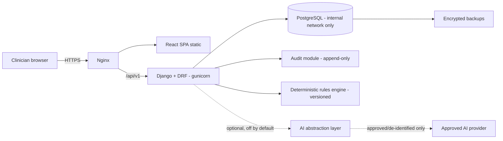
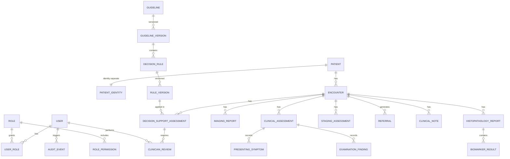

# Architecture, ERD, Stage 1 Plan and Risks

## 1. System architecture (modular monolith)
One Django/DRF deployable with strict module boundaries; PostgreSQL is the only datastore; React SPA added in Stage 6; Nginx terminates TLS. AI sits behind an abstraction layer, disabled by default, never in the core clinical path.

Planned Django apps: accounts, registry, clinical, investigations, referrals, decision_support, reporting, audit, ai (interface only), core (health/shared).



## 2. Repository structure
```
clinical-decision-support/
  backend/ (config/, apps/)   frontend/   tests/
  docs/{architecture,api,clinical-governance,deployment}
  infrastructure/   scripts/   .github/workflows/ci.yml
  docker-compose.yml  .env.example  .gitignore  README.md
```

## 3. Entity relationship diagram
Identity is held in `patient_identity`, separate from the pseudonymous `patient` record, so analytics can exclude identity tables.


Conventions: every clinical value has a status (recorded / pending / unavailable / not_indicated / not_recorded), source, recorded_by, recorded_at; no hard deletes of clinical data. Guidelines and rules carry source citation, version, approved_by, approved_at. `audit_event` is insert-only (DB permissions plus hash chain, Stage 2).

## 4. Stage 1 plan (delivered)
1. Repo + secret hygiene. 2. Django 5.2 LTS, DRF, OpenAPI. 3. PostgreSQL 16 in Docker, not published. 4. Split settings, Argon2, deny-by-default permissions, throttling. 5. Health endpoint + tests. 6. CI: ruff, migration check, pytest, pip-audit, gitleaks. 7. VPS bootstrap script.
Not included yet: models, auth flows, Nginx/HTTPS, backups, frontend, any clinical rules.

## 5. Risks
**Technical:** schema churn before clinical review; single VPS is a single point of failure; unreliable connectivity in PNG; restore procedures untested.
**Security/privacy:** dev VPS is not approved for identifiable data; PNG health-data, privacy, research-ethics and medical-device requirements unassessed; secret leakage; audit tampering; leakage to external AI services.
**Clinical:** unverified rules could cause harm; automation bias; missing data misread as negative; guidelines may not fit local resources; no clinical validation yet.
